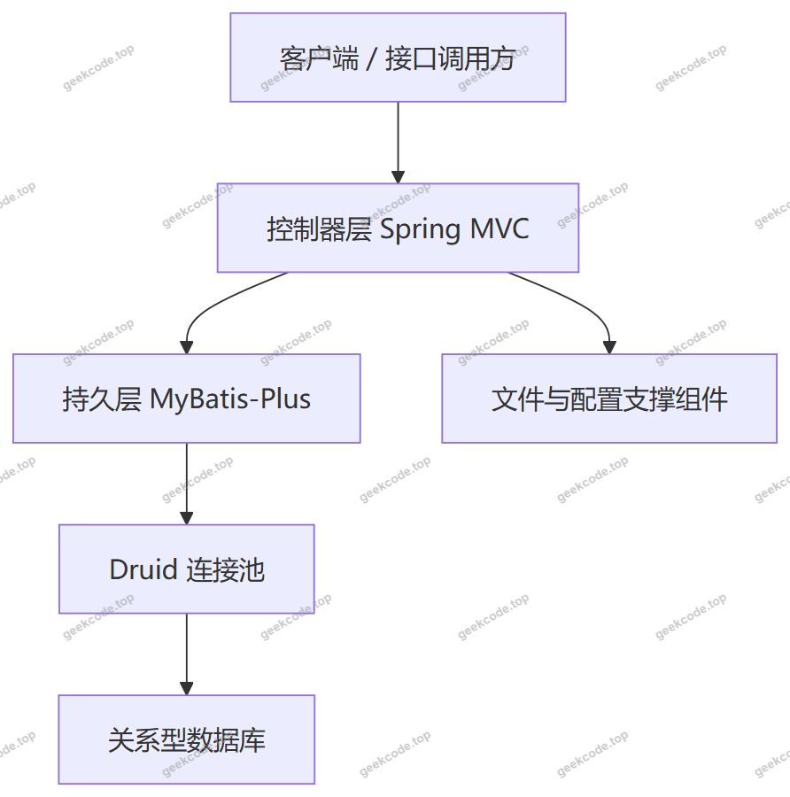
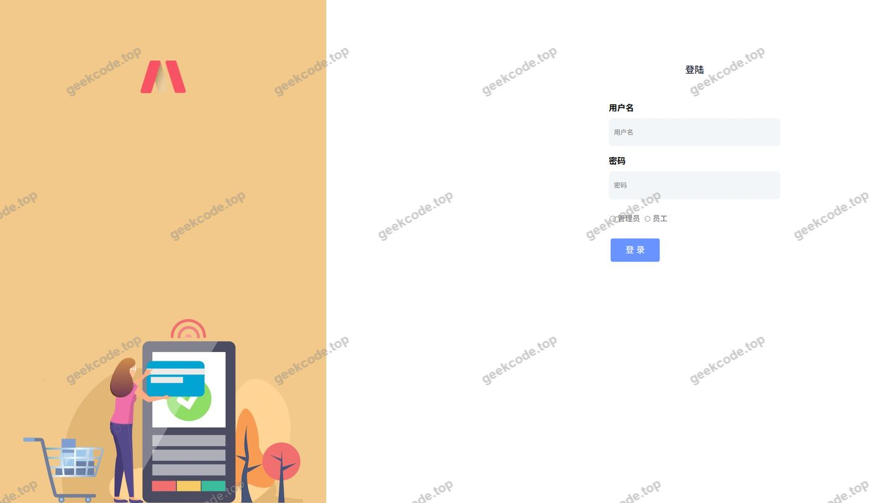
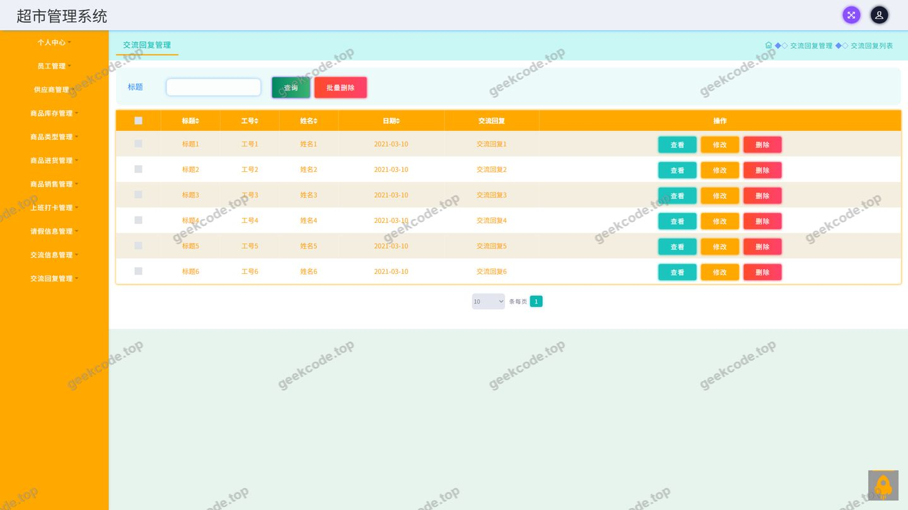
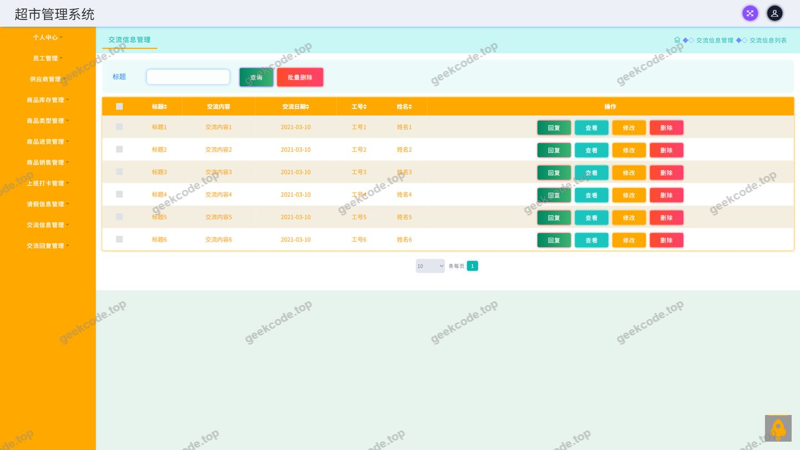
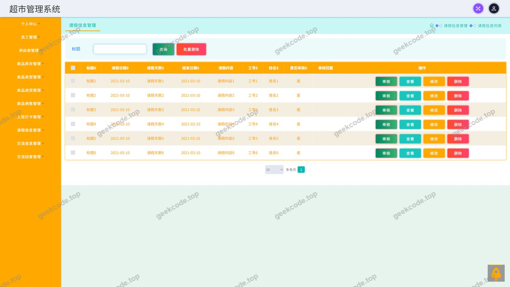
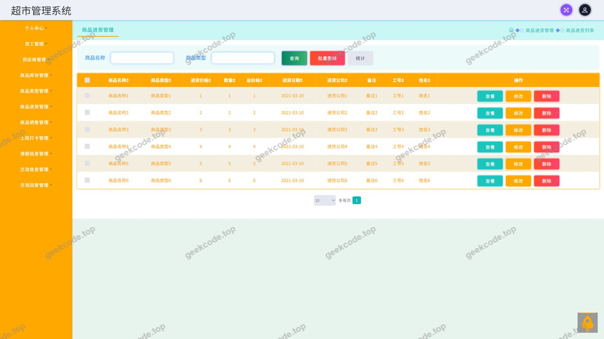
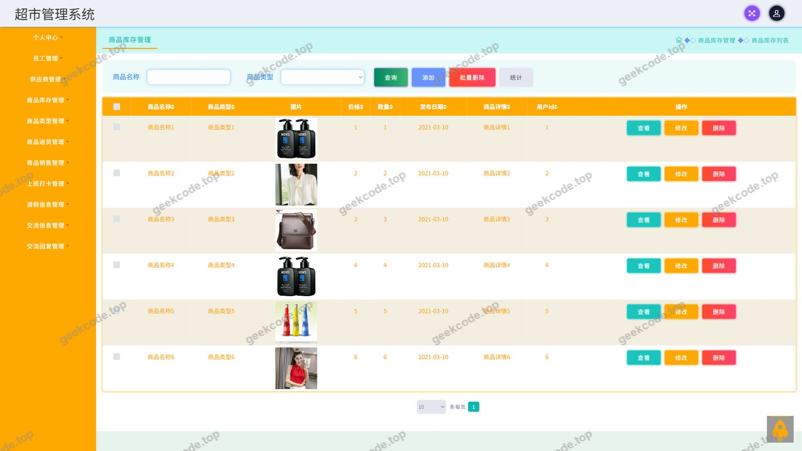
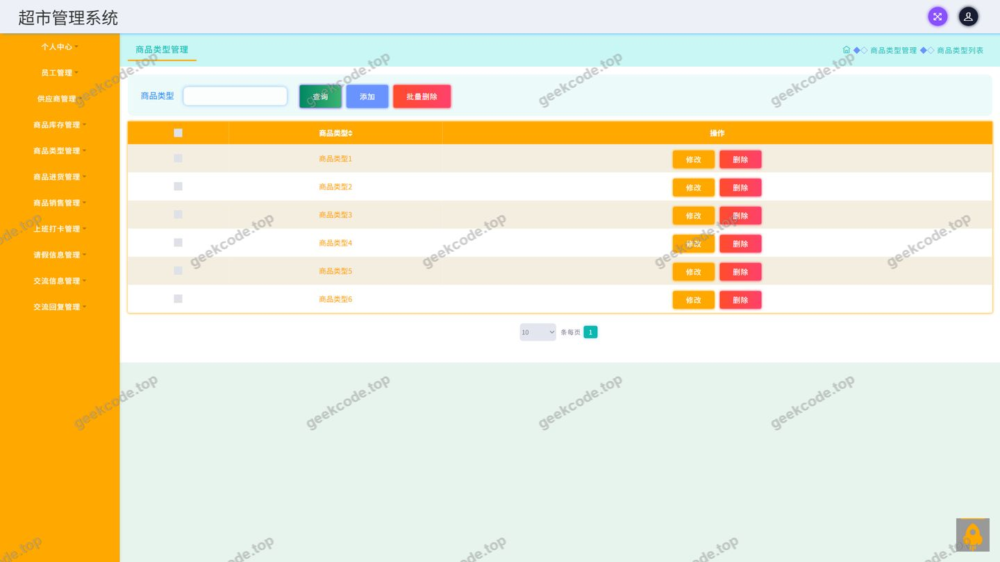
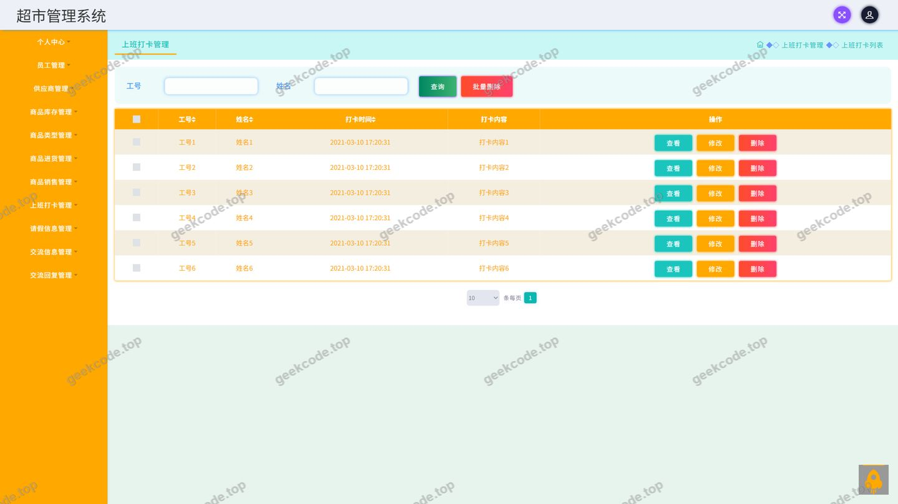
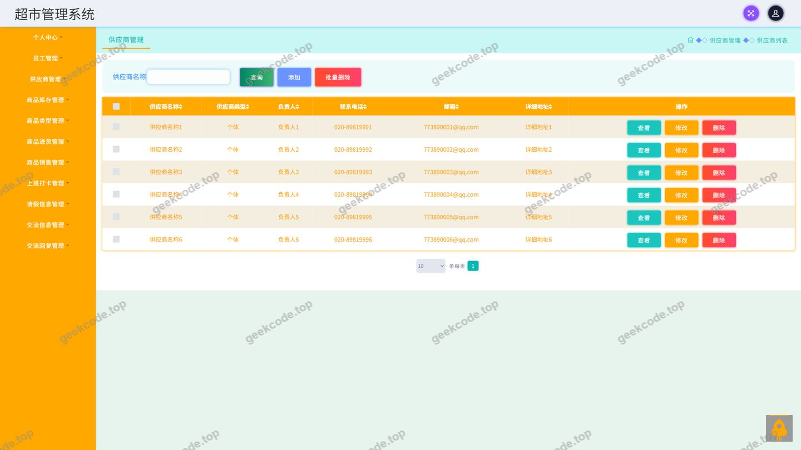

# ssm超市管理系统-java毕业设计

> 🎓 **计算机毕业设计 · ssm超市管理系统-java毕业设计**
>
> 本仓库只放**项目介绍 + 运行截图**（截图是站点带水印的原图，存在仓库 `images/` 里）。
>
> 👉 **完整可运行源码 / 数据库脚本 / 部署文档：[点我获取](https://geekcode.top/archives/ssm%E8%B6%85%E5%B8%82%E7%AE%A1%E7%90%86%E7%B3%BB%E7%BB%9F-java%E6%AF%95%E4%B8%9A%E8%AE%BE%E8%AE%A1?utm_source=github)**
>
> 💬 咨询微信：**ir9372**　|　🌐 更多项目：[极客代码 geekcode.top](https://geekcode.top/?utm_source=github)
>
> 📌 项目详情页：<https://geekcode.top/archives/ssm%E8%B6%85%E5%B8%82%E7%AE%A1%E7%90%86%E7%B3%BB%E7%BB%9F-java%E6%AF%95%E4%B8%9A%E8%AE%BE%E8%AE%A1?utm_source=github>

<table><td width="230" align="center"> <b>扫码加微信 ir9372</b></td><td valign="middle">📦 源码 = 项目介绍 + 全部运行截图 + 数据库 + 部署文档 👉 点上方任意截图，直接跳到 <b>极客代码 geekcode.top</b> 详情页</td></table>

---

<h1>ssm超市管理系统-java毕业设计</h1>
<h2>项目概述</h2>

本项目为超市管理系统的后端服务实现，采用 SSM 技术体系（Spring + Spring MVC + MyBatis-Plus）构建，属于纯接口型（pure-api）应用，不包含独立的前台展示页面与后台管理路由。系统围绕超市日常经营与内部协同两条主线展开：经营侧覆盖商品类型、商品库存、商品进货、商品销售与供应商等基础数据的管理；内部协同侧覆盖员工上班打卡、请假信息、交流信息与交流回复等业务。系统提供统一的登录入口，并包含系统配置、文件处理与公共接口等支撑能力。适用场景为中小型超市的商品进销存数据管理与员工日常事务管理，使用人群包括超市经营管理人员与门店员工。整体接口通过控制器层对外暴露，底层依托 MyBatis-Plus 完成数据持久化，使用 Druid 管理数据库连接，并以 JUnit 支撑单元测试。

<h2>技术架构</h2>
<h3>整体架构</h3>

系统采用经典的分层结构，请求经控制器层接收后，通过持久层组件访问数据库，数据库连接由 Druid 连接池统一管理。

<h3>后端架构说明</h3>

项目为纯接口型应用，代码上下文中未提供任何前台路由或后台路由，也未提供视图模板信息，因此系统以 HTTP 接口形式对外提供服务，请求的接收与分发由 Spring MVC 承担。

从依赖上下文看，项目引入了 Spring 框架的核心模块：

<ul>
<li><code>spring-core</code>、<code>spring-beans</code>、<code>spring-context</code>、<code>spring-context-support</code>：负责容器与 Bean 的生命周期管理、上下文支撑能力；</li>
<li><code>spring-web</code>、<code>spring-webmvc</code>：负责 Web 层请求映射与控制器调度；</li>
<li><code>spring-jdbc</code>、<code>spring-tx</code>：负责数据访问抽象与事务管理；</li>
<li><code>spring-aop</code>：提供面向切面能力，可用于事务、日志等横切逻辑；</li>
<li><code>junit</code>：用于单元测试。</li>
</ul>

持久层采用 MyBatis-Plus，在常规 MyBatis 映射能力之上提供通用 CRUD 等增强操作；连接池采用 Druid，负责连接的创建、复用与监控。控制器共 12 个，分别为 <code>CommonController</code>、<code>ConfigController</code>、<code>FileController</code>、<code>GongyingshangController</code>、<code>JiaoliuhuifuController</code>、<code>JiaoliuxinxiController</code>、<code>QingjiaxinxiController</code>、<code>ShangbandakaController</code>、<code>ShangpinjinhuoController</code>、<code>ShangpinkucunController</code>、<code>ShangpinleixingController</code>、<code>ShangpinxiaoshouController</code>，分别对应公共能力、系统配置、文件处理以及供应商、交流回复、交流信息、请假信息、上班打卡、商品进货、商品库存、商品类型、商品销售等业务领域。

<h3>数据库设计要点</h3>

系统使用关系型数据库承载业务数据，并通过 Druid 连接池进行访问。根据控制器所覆盖的业务域，可归纳出以下数据实体范围：商品类型、商品库存、商品进货、商品销售、供应商、员工考勤（上班打卡）、请假信息、交流信息、交流回复，以及系统配置与文件相关数据。

现有上下文未提供具体表结构、字段定义与表间关联关系，因此数据库的详细设计（字段、主外键、索引）根据现有信息无法确定。

<h3>核心技术选型理由</h3>
<ul>
<li>Spring 体系：通过容器管理 Bean 与依赖关系，配合声明式事务保证商品进货、销售、库存等涉及数据变更的操作具备事务一致性；</li>
<li>Spring MVC：以控制器为单元组织接口，每个业务域一个控制器，职责边界清晰，便于按模块维护与扩展；</li>
<li>MyBatis-Plus：在保留 SQL 可控性的同时提供通用数据访问能力，适合以表为核心的进销存类业务；</li>
<li>Druid：提供连接池管理与运行状态监控能力，便于观察数据库连接使用情况；</li>
<li>JUnit：为业务代码提供单元测试基础。</li>
</ul>
<h2>功能模块</h2>

项目在代码结构中未区分前台与后台路由，以下按业务职责划分为业务操作类模块与管理支撑类模块。

<h3>业务操作类模块</h3>
<ul>
<li>登录：系统提供登录页面，作为使用者进入系统的入口。登录接口的具体归属控制器在现有上下文中未体现。</li>
<li>员工信息：截图功能列表中包含员工页面，用于员工基础信息的维护与查看。现有控制器列表中未出现对应的员工控制器，其接口实现方式根据现有信息无法确定。</li>
<li>上班打卡：由 <code>ShangbandakaController</code> 提供，用于记录员工的每日上班打卡行为，是考勤管理的数据来源。</li>
<li>请假信息：由 <code>QingjiaxinxiController</code> 提供，用于员工请假申请相关信息的记录与管理。</li>
<li>交流信息：由 <code>JiaoliuxinxiController</code> 提供，用于员工之间或内部通知类信息的发布与查询。</li>
<li>交流回复：由 <code>JiaoliuhuifuController</code> 提供，用于对交流信息进行回复，形成完整的内部沟通链路。</li>
<li>商品类型：由 <code>ShangpinleixingController</code> 提供，用于维护商品分类体系，为商品库存与进销业务提供分类依据。</li>
<li>商品库存：由 <code>ShangpinkucunController</code> 提供，用于管理商品当前库存数据，反映商品的在库数量状态。</li>
<li>商品进货：由 <code>ShangpinjinhuoController</code> 提供，用于记录商品入库进货业务，是库存数量增加的业务来源。</li>
<li>商品销售：由 <code>ShangpinxiaoshouController</code> 提供，用于记录商品销售出库业务，是库存数量减少的业务来源。</li>
<li>供应商：由 <code>GongyingshangController</code> 提供，用于维护供货单位的基础档案信息，与商品进货业务相关联。</li>
</ul>
<h3>管理支撑类模块</h3>
<ul>
<li>系统配置：由 <code>ConfigController</code> 提供，用于维护系统运行所需的配置项。</li>
<li>文件处理：由 <code>FileController</code> 提供，用于处理系统中的文件上传、下载或存取类操作。</li>
<li>公共接口：由 <code>CommonController</code> 提供，承载多个业务模块共用的通用能力。</li>
</ul>
<h2>用户角色与权限</h2>

系统设有登录入口，说明存在身份认证环节。结合截图功能列表（登录、员工、交流回复、交流信息、请假信息、上班打卡、商品进货、商品库存、商品类型）与控制器划分，系统使用者在业务上可归纳为以下两类：

<h3>经营管理人员</h3>
<ul>
<li>商品类型管理：维护商品分类数据，对应 <code>ShangpinleixingController</code>；</li>
<li>商品库存管理：查看与维护商品库存数据，对应 <code>ShangpinkucunController</code>；</li>
<li>商品进货管理：登记与维护进货记录，对应 <code>ShangpinjinhuoController</code>；</li>
<li>商品销售管理：登记与维护销售记录，对应 <code>ShangpinxiaoshouController</code>；</li>
<li>供应商管理：维护供应商档案，对应 <code>GongyingshangController</code>；</li>
<li>系统配置：维护系统配置项，对应 <code>ConfigController</code>；</li>
<li>文件处理：进行文件相关操作，对应 <code>FileController</code>；</li>
<li>员工信息：通过员工页面查看与维护员工基础信息；</li>
<li>内部协同数据：查看交流信息与交流回复等内容。</li>
</ul>
<h3>门店员工</h3>
<ul>
<li>登录：使用登录页面进入系统；</li>
<li>上班打卡：提交每日上班打卡记录，对应 <code>ShangbandakaController</code>；</li>
<li>请假信息：提交与管理请假信息，对应 <code>QingjiaxinxiController</code>；</li>
<li>交流信息与交流回复：参与内部交流并可对信息进行回复，对应 <code>JiaoliuxinxiController</code>、<code>JiaoliuhuifuController</code>。</li>
</ul>

现有上下文未提供角色权限表、鉴权拦截配置或接口级的访问控制规则，因此上述两类角色的划分依据为业务职责与功能归属，各角色可访问接口的精确边界根据现有信息无法确定。

<h2>项目特色与创新点</h2>
<ul>
<li>业务闭环设计：商品类型、进货、库存、销售与供应商构成完整的进销存链路，进货与销售分别作为库存增减的业务来源，形成商品数据的一体化管理闭环。</li>
<li>经营与协同并重：在商品经营功能之外，集成了上班打卡、请假信息、交流信息与交流回复等内部管理能力，覆盖超市门店“人”与“货”两个维度的日常管理需求。</li>
<li>按业务域组织的控制器结构：十二个控制器与业务实体一一对应，模块边界清晰，便于按业务方向独立开发与后续扩展。</li>
<li>纯接口架构：系统以接口形式对外提供服务，便于对接不同的客户端形态，前端实现方式不受后端约束。</li>
<li>通用能力下沉：通过 <code>CommonController</code>、<code>ConfigController</code>、<code>FileController</code> 集中承载公共接口、配置维护与文件处理等横切能力，避免在各业务控制器中重复实现。</li>
</ul>
<h2>部署环境</h2>

系统运行所需的环境如下：

<ul>
<li>JDK：运行 Java 应用所需的开发与运行环境。具体版本在现有上下文中未提供，根据现有信息无法确定。</li>
<li>构建工具：项目依赖以 Maven 构件形式列出（如 <code>spring-core</code>、<code>spring-webmvc</code>、<code>mybatis-plus</code>、<code>druid</code> 等），需使用 Maven 进行依赖管理与构建。</li>
<li>数据库：关系型数据库，用于承载商品、库存、进货、销售、供应商、考勤、请假、交流及配置等业务数据。现有上下文未明确数据库类型与版本，根据现有信息无法确定。</li>
<li>数据库连接池：Druid，需在应用配置中提供数据库连接参数。</li>
<li>持久层框架：MyBatis-Plus，随应用一同部署。</li>
<li>Web 容器：应用基于 Spring MVC，需部署于支持 Servlet 规范的 Web 容器中。现有依赖上下文中未列出内嵌容器相关构件，具体容器形态根据现有信息无法确定。</li>
<li>测试运行环境：JUnit，用于执行单元测试。</li>
</ul>

前端运行环境（如 Node.js、微信开发者工具等）在本项目中不涉及：项目类型为纯接口应用，未提供前台或后台路由信息，也未在前台导航菜单、个人中心菜单与后台路由中给出任何前端配置内容。

<h2>五、技术特性</h2>
<ul>
<li>使用 MyBatis-Plus 简化数据访问层开发</li>
</ul>
<h2>六、功能模块截图</h2>
<h3>后台管理端</h3>
<h4>页面-登录</h4>

<h4>页面-交流回复</h4>

<h4>页面-交流信息</h4>

<h4>页面-请假信息</h4>

<h4>页面-商品进货</h4>

<h4>页面-商品库存</h4>

<h4>页面-商品类型</h4>

<h4>页面-上班打卡</h4>

<h4>页面-员工</h4>

---

## 获取完整源码

| 项目 | 说明 |
| --- | --- |
| 项目名 | ssm超市管理系统-java毕业设计 |
| 运行截图 | 本文 10 张（站点带水印原图，仓库 `images/` 目录） |
| 完整源码 | [https://geekcode.top/archives/ssm%E8%B6%85%E5%B8%82%E7%AE%A1%E7%90%86%E7%B3%BB%E7%BB%9F-java%E6%AF%95%E4%B8%9A%E8%AE%BE%E8%AE%A1?utm_source=github](https://geekcode.top/archives/ssm%E8%B6%85%E5%B8%82%E7%AE%A1%E7%90%86%E7%B3%BB%E7%BB%9F-java%E6%AF%95%E4%B8%9A%E8%AE%BE%E8%AE%A1?utm_source=github) |
| 咨询微信 | **ir9372**（备注：jingpin-yuanma） |
| 更多项目 | [极客代码 geekcode.top](https://geekcode.top/?utm_source=github) |

> 需要源码、部署、改配置、跑不起来等问题，加微信 ir9372 沟通，说明项目名即可。
